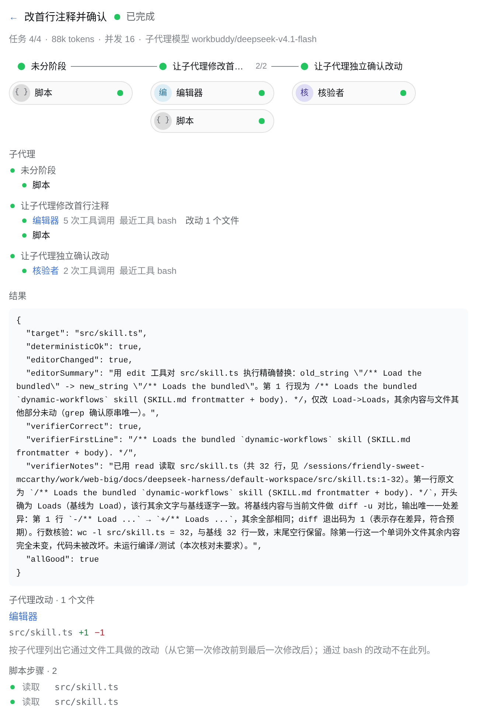
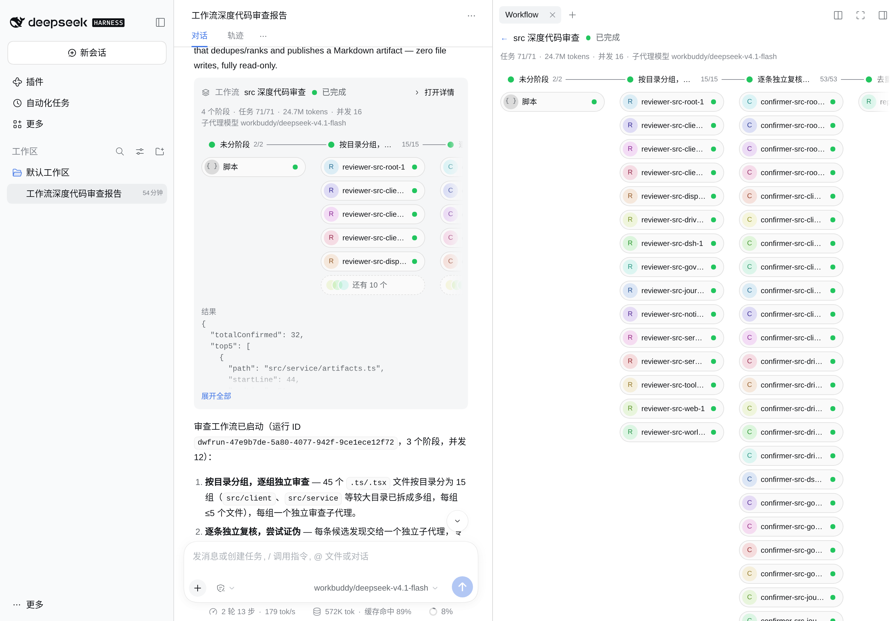

# dsh-dynamic-workflow

把 ZCode 的 **dynamic workflow**（动态工作流）完整搬进 DeepSeek Harness（DSH），并用 DSH 可改写的 agent loop 做了几处 ZCode 做不到的增强。

模型针对一个小的 facade 写一段 **TypeScript 编排脚本**（`agent()`、`.ask<T>()`、`files.*`、`git.*`、`world.run`、`report`、`artifact.*`、`phase()`、`hole<T>()`）。Host 先类型检查并画出阶段图，请用户确认，然后在沙箱子进程里运行：每个子代理是一个真实的 DSH 子 agent，每一步都写入 SQLite journal（可 resume / amend / 补留白 / 升级提问），结束时用 `<task-notification>` 把结果送回主代理；Web 端把整个运行画成 ZCode 式的横向时间线。

ZCode 的纯逻辑（编译器、分析器、引擎、沙箱，约 2.6 万行，Apache-2.0）原样放在 `vendor/`；DSH 侧重写的是 driver、run service、工具、通知和 UI。

## 安装

需要 Node ≥ 24.9 与 DSH ≥ 0.2.2-rc.3。

### 方式一：从 GitHub Packages 安装（推荐）

首次安装前，在 `~/.npmrc` 配置 GitHub Packages（需带 `read:packages` 权限的 GitHub PAT）：

```ini
@lonesigma1998:registry=https://npm.pkg.github.com
//npm.pkg.github.com/:_authToken=你的_GITHUB_PAT
```

然后直接按包名安装：

```sh
dsh plugin --profile web add @lonesigma1998/dsh-dynamic-workflow        # 或 --profile headless / tui
```

Desktop 桌面端在左侧栏 **Plugins → Add plugin** 中输入 `@lonesigma1998/dsh-dynamic-workflow` 即可安装，后续也支持在 Plugin Manager 内检测版本并一键更新。

### 方式二：本地源码构建安装

```sh
npm install            # 只装构建/测试依赖（esbuild、typescript 5.9、zod、tsx…）
npm run build          # → lib/index.js（Host 半，TypeScript 编译器已打包进去）+ lib/client.js（Web 半）
dsh plugin --profile web add "$(pwd)"        # 或 --profile headless / tui；Desktop 可在 Add plugin 填绝对路径
```

### 自动发布（GitHub Actions）

仓库已配置 [`.github/workflows/publish.yml`](.github/workflows/publish.yml)：使用 `npm version patch|minor` 更新版本号并推送 `v*` 标签（`git push --follow-tags`），或在 GitHub Actions 页面手动触发，会自动构建、运行引擎与 journal 契约测试并发布到 GitHub Packages（使用内置 `GITHUB_TOKEN`，无需额外 Secret）。

包的 `cordis.patch.yml` 会把 Host 半和 Web 半作为同一个 Loader entry（id `dynamic-workflow`）插入 profile。DSH 自带的 `workflow` 工具（纯 JS PTC 编排脚本）是另一个功能，不冲突。

### 配置（`$DSH_HOME/profiles/<profile>/cordis.patch.yml`）

```yaml
- id: dynamic-workflow
  config:
    confirm: ask              # ask（默认，每次启动都确认）| never（headless）| ask-or-allow
    holdTurnWhileRunning: false   # headless/SDK 设 true：run 未结束前主代理的 turn 不关
    skillGate: true           # 未加载 dynamic-workflows skill 前拒绝提交脚本
    defaultMaxConcurrency: 8  # 默认按 CPU 2–16
    readOnlySubagents: ['reviewer*']   # 这些 persona 的子代理只拿只读工具
    governor: { initial: 8 }  # 进程级 AIMD 限流；false 关闭
    quotaAutoResume: true     # 额度耗尽停下的 run 在重置后自动续跑（中文“额度已用尽”也识别）
    mode: alwaysOn            # alwaysOn（默认）| onDemand（/workflow 之前不向模型提供工具）| disabled
    routing: explicit         # explicit（默认，只在要求时）| suggest（先说明做法和大概成本再问）| auto（实质性任务默认用）
    resultSchema: exact       # exact（默认，子代理结果结构原样发给模型）| relaxed（降到 DSH 子集，给不接受复杂 schema 的网关）
```

`routing` 还可以按会话切换：`/dwf routing suggest`，或在右侧栏“工作流”列表页的“工作流触发方式”里点选（会写进会话记录，重开仍生效）。

## 用法

- 对主代理说“用工作流……”，或 `/workflow <要做的事>`。
- `/dwf list` · `/dwf stop <run_id>` · `/dwf resume <run_id>`。
- 工具：`create_workflow`、`amend_workflow`、`fill_workflow_hole`、`resume_workflow_run`、`stop_workflow_run`、`resolve_workflow_question`、`get_workflow_run`、`list_workflow_runs`、`save_workflow`、`list_saved_workflows`、`eval_workflow_snippet`。
- 草稿保存在 `<cwd>/.dsh/workflow-drafts/`，存档工作流在 `<cwd>/.dsh/workflows/` 与 `$DSH_HOME/workflows/`，沙箱入口文件在 `<cwd>/.dsh/workflow-runs/`，journal 与产物在 `$DSH_HOME/state/dynamic-workflow/`。

## Web 界面

以下截图都来自真实的 DSH 0.2.2-rc.4 Web 和真实模型（`docs/screenshots/`）。

- **工具卡**（`create_workflow` / `amend_workflow`）：模型还在写脚本时，阶段随着 `phase("…")` 一站一站落到轨道上（打字光标）；确认前显示静态阶段图；类型检查失败时显示诊断。
- **确认卡**（占据输入框位置）：静态阶段图、并发与子代理模型、脚本，按钮为 运行 / 本会话始终允许 / 拒绝 / 提修改意见（带反馈，不运行）。
- **运行卡**（对话里独立的一行）：启动后由 `dynamicWorkflowRuns` 会话投影实时点亮——运行中的站会脉动、轨道行进，子代理是挂在站下的药丸，点开就在右侧栏打开它的对话；停止 / 续跑 / 打开详情；结束后显示结果与报告。DSH 会在一个 turn 结束后把它的工具调用折叠起来，而 run 比启动它的 turn 活得久，所以运行卡不放在工具卡里，而是作为 turn 级的对话节点（`groupTree: 'turn'`），始终可见；重启 Host 后从持久化的进度记录恢复。
- **通知条**：送给主代理的 `<task-notification>`、升级、留白等消息显示为一行可展开的状态条（按界面语言显示摘要）；子代理对话里，工作流派给它的任务显示为“工作流任务”。
- **右侧栏运行面板**（可通过顶部会话栏“工作流”按钮或右侧栏导览随时打开，即使会话还未运行过工作流）：
  - **竖向 Spine 阶段轨**（带并行分支轨道与分叉/汇合接头、阶段折叠、每阶段最多钉住 5 个子代理药丸 + 可展开的分组名册，避免大扇出拉爆侧栏），内嵌待答问题、留白状态，点击子代理即可打开对话，并显示工具调用数、最近工具、缓存命中、改动文件数。
  - 报告、结果 / 错误、脚本；超出实时投影窗口（8 个 run）的历史运行仍可直接从 SQLite 快照查看与续跑。
  - **产物与预设看板**：Markdown、文本、图片直接预览，主产物默认展开；`artifact.chart` / `table` / `metrics` / `board` 预设看板通过增量游标从 `report(item, id)` 实时渲染（折线/柱状/散点、线性/对数坐标、指标卡、去重表格、状态看板）。下载会以文件形式保存，不打开新窗口。HTML 和 SVG 只显示源码，不在应用里渲染（与 ZCode 相同）；后端也只以纯文本或位图返回预览，并附带沙箱 CSP。
  - **脚本步骤**：脚本自己读了哪些文件、搜了什么、跑了哪些命令。
  - **子代理改动**：按子代理列出它通过文件工具改了哪些文件（+行 −行），点开看 diff。
  - **配置**：运行中或停下后改并发和子代理模型。只改并发时原地生效；其余情况开一次修订运行，复用已完成的工作。
- **确认卡上可直接改设置**：并发和子代理模型，改过的会显示“· 原为 X ↺”，点一下就能还原。
- **列表页**（右侧栏“工作流”不指定运行时）：本会话的运行、工作流触发方式，以及保存的工作流（全局 / 本项目、最近几次运行、一键“运行”，不经模型、不再确认）。




## 相比 ZCode 的增强（DSH 原生）

| 增强 | 做法 |
|---|---|
| Turn 边界闸门 | `agent/turn-stopping`：主代理想结束 turn 但还欠某个 run 一个回答 / 补全时，注入一次 `<workflow-blocked>` 提醒，而不是靠定时器 |
| Headless 保持 | `holdTurnWhileRunning`：run 存活期间主代理 turn 不关闭，升级、留白、终态通知都在同一 turn 内到达 |
| 运行状态上下文 | `systemPrompt.context` 注入 `<workflow-runs>`（只在变化时重发）：模型始终知道哪些 run 在跑、在等它什么，无需轮询 |
| 进程级限流 | `llm/stream` 上的 AIMD 治理器（每个 provider/model 一个桶），429 时整体降并发，主代理请求不排队 |
| 写操作追踪 | `tools/pre-execute` 统计子代理工具调用与写入，导入缓存在首次写入工作区处截断 |
| 只读子代理 | 按 persona 名配置只读工具集 |
| 可重载的进度 | 进度写成 `ignorable` 的 plugin record（`appendPluginRecord`），任何 DSH 版本都能重新打开会话 |
| 子代理即 DSH 子会话 | 每个子代理是带 `subagent/descriptor` 的一次性子会话：在 Web 里可直接打开它的完整对话，日志随会话持久化 |

## 测试

离线测试直接从相邻的 `../deepseek-harness` 源码跑真实的 DSH（先在那边 `pnpm install`；路径可用 `DSH_REPO` 指定）：

```sh
npm test               # 引擎冒烟、治理器、加固回归、额度续跑、snippet、typed 工具 schema、9 个集成场景、wire 级端到端
npm run test:bundle    # 集成场景 + wire 测试跑在打包后的 lib/index.js 上
npm run test:client    # 按 Web shell 的方式加载 lib/client.js 并渲染每个组件
npm run typecheck
npm run test:vendor    # ZCode 引擎自带的 vitest（2037 个用例）+ ZCode 的 journal 契约套件跑在本插件的 SQLite journal 上（83 个）
```

- **集成场景**（脚本化模型）：诊断、完整运行、升级提问、停止→续跑、amend 导入缓存、补留白、turn 闸门、headless 保持、其他会话不能控制别人的 run。
- **与 ZCode 对齐的行为**：
  - `drafts.ts` 跑在真实的 DSH 文件工具和“先读再改”策略上：编译失败后直接改草稿不需要重读；子代理改动的行数统计和 diff 准确。
  - `amend-inflight.ts` 跑在 JSONL 持久化上：修订一个正在跑的运行时，在途任务在原会话的基础上继续，而不是从头重来。
  - `budget.ts`：子代理的联网搜索预算。
  - `modes.ts` 通过真实的命令运行时验证：onDemand 激活、按会话切换 routing、disabled。
- **加固回归**（`tests/dsh/hardening.ts`）：产物 id 目录穿越被拒、另一个存活 Host 正在跑的 run 不会被当成孤儿、排队请求中止后不残留监听器、真实 ripgrep 下含 `:1:` 的文件名解析正确且与无 rg 时排除相同目录、停止 run 会杀掉它正在等的 `world.run` 子进程、任务计数包含表外节点。
- **wire 级端到端**（`tests/dsh/wire.ts`）：真实的 `llm-pi-ai` 适配器（pi-ai，`anthropic-messages` 协议）经真实 HTTP 连到本地的 Anthropic 兼容网关（`tests/dsh/mock-anthropic.ts`），加上 `llm-retry`、JSONL 会话持久化、真实的 `skill` 工具。验证：skill 闸门先拒绝、加载 skill 后放行；所有工具 schema 经 pi-ai 转换后到达网关；网关 429 被吸收；用量进入 journal；会话 JSONL 经持久化后端读回；在一个全新的 Host 里 resume 会话后，运行卡片状态恢复、对话可继续。只有模型是模拟的。

**真实端到端**（真实 `dsh` + 真实模型；需要 Node ≥ 24.9、pnpm 和网络）：

```sh
cp .env.example .env   # 填入网关地址、密钥、模型（.env 已被 gitignore）
npm i -g @deepseek-ai/dsh@next pnpm
DWF_E2E_INSTALL=1 npm run test:live          # headless：用 `dsh plugin add` 装进 headless profile 后跑
node tests/e2e/web-live.mjs <work> <shots>   # Web：真实 `dsh web` + Playwright，逐个界面截图
```

时间受限的 shell 里可分段：`DWF_E2E_KEEP=1 DWF_E2E_PHASE=run …` 先跑；若被截断，`--continue <dir>` 用 `--session-id` 重新打开同一个会话让它收尾（运行已结束则汇总，被中断则续跑）；最后 `--verify <dir>` 检查。

`test:live` 会先探测网关（x-api-key / Bearer、模型名是否带 `[1m]` 后缀），在临时 `DSH_HOME` 和一个埋了 4 个 bug 的小仓库里让模型“用工作流”审查代码，然后检查 17 项：run 完成且用了 ≥2 个子代理、回答里找到埋下的 bug、每个子代理的对话都作为 DSH 会话持久化且可在 Web 打开、token 计量、草稿与沙箱入口文件、会话日志里的进度记录全部 `ignorable`、skill 先于 `create_workflow` 加载、`<task-notification>` 送达，最后用 `--session-id` 重新打开会话确认可重载。
已在 DSH 0.2.2-rc.4 + `workbuddy/deepseek-v4.1-flash` 上跑通（17/17，`dsh plugin add` 安装与按路径插入两种方式都验证过）；Web 端从提问、流式草稿、确认、运行、完成、通知、运行面板到重启后恢复、打开子代理对话都在真实浏览器里走通。

### 中大型任务实测：让工作流审查本插件自己

在真实 Web 里让模型“用工作流深度审查本仓库 `src/`”。模型写出的脚本分 4 个阶段：按目录分组审查（15 个审查子代理）→ 每条候选发现交给一个独立子代理尝试证伪（53 个复核子代理）→ 去重排序 → 写报告。共 71 个任务、并发 16、24.7M tokens；中途 Host 被重启约 9 次（沙箱的时间限制），每次都从 journal 续跑，已完成的子代理从缓存重放。



它确认了 32 个问题（3 高 / 14 中 / 15 低，报告见 [`docs/reviews/2026-11-18-src-deep-review.md`](docs/reviews/2026-11-18-src-deep-review.md)），全部 3 个高危和全部 14 个中危都已修复并补了回归测试，另修了 3 个低危。复测时还发现：按路径插入插件时进度记录没有写进会话（`@deepseek-ai/dsh-session` 从插件目录解析不到），现在会退回到从 Host 入口解析同一个模块实例。

这次实测暴露的两点体验问题：

- **“只读”只是提示词**。子代理在 DSH 的 workspace-write 模式下仍能写文件、跑任意 shell（ZCode 同样没有只读 persona）。需要真正只读时，请把会话切到 DSH 的只读访问模式——子代理通过委派的沙箱模式继承它；或在插件配置里为审查类 persona 配只读工具集（见“只读子代理”）。
- **token 消耗主要来自脚本的扇出方式**。“每条发现一个复核子代理”让 53 个子代理各自重读源码；确认卡会显示子代理数，可以在确认前用“提修改意见”让模型合并复核批次。

## 对照实验

同一模型、同一个埋了 14 个 bug 和 5 个诱饵的小仓库，不用工作流和用工作流各跑两次（`tests/eval/`，详见 [`docs/eval/2026-11-18-ab-review.md`](docs/eval/2026-11-18-ab-review.md)）：

- 埋下的 bug 两组都找到 10–11 个，都没有误报诱饵。
- 工作流组额外找到 1–3 个真实存在、但没有埋的边界问题。
- 代价是约 15–25 倍的 token、4–5 倍的时间。

在一个上下文装得下的小任务上，工作流主要是开销；更大规模下的分界点还没有测。

## 已知限制

- 桌面端：DSH 的 `desktop` profile 只能由 Electron 应用管理（CLI 连 `dsh plugin --profile desktop add` 都拒绝），所以没法在这里验收。桌面端运行的是同一套 Web 应用，Web 端的端到端覆盖了它的界面；安装和最终验收需要在桌面应用里进行。
- `world.run` 的命令由插件自己的执行端口运行（与 ZCode 相同，命令在确认卡的脚本里可见），不经过 DSH 的沙箱策略。
- 子代理对话的打开依赖 ui-subagent 的 `subagentchat` 标签页；不可用时退回主面板打开。子代理是一次性记录（只读），续跑由 run 的 journal 重放完成，而不是在子代理对话里继续发消息。
- 样式同时用两种方式交付：DSH 0.2.2-rc.4 的插件 bundle 自行注入 `<style data-plugin>`，较新的源码读 `meta.stylesheets`；两种都提供。
