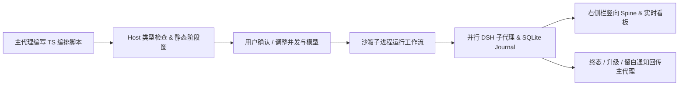
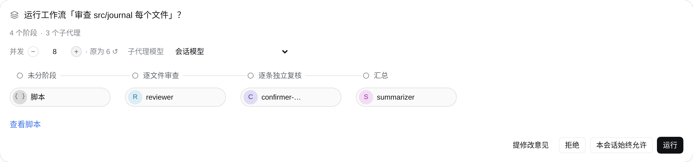

<div align="center">


# dsh-dynamic-workflow

**面向 DeepSeek Harness（DSH）的强类型 TypeScript 多代理动态工作流插件**

*Typechecked TypeScript multi-agent dynamic workflow plugin for [DeepSeek Harness](https://github.com/deepseek-ai/deepseek-harness), ported from [ZCode](https://github.com/zai-org/ZCode) (Apache-2.0).*

[](https://www.npmjs.com/package/@sigmacamellia/dsh-dynamic-workflow)
[](./LICENSE)
[](https://nodejs.org/)
[](https://github.com/deepseek-ai/deepseek-harness)
[](https://github.com/LoneSigma1998/dsh-dynamic-workflow/actions/workflows/publish.yml)

[快速开始](#快速开始) · [核心特性](#核心特性) · [界面预览](#界面预览) · [配置参考](#配置参考) · [DSH 原生增强](#dsh-原生增强) · [安全与限制](#安全边界与已知限制) · [开发与测试](#开发与测试) · [协议与致谢](#开源协议致谢与免责声明)

</div>

> [!NOTE]
> 本项目为**非官方社区插件**，基于 [ZCode](https://github.com/zai-org/ZCode) 的 Apache-2.0 开源动态工作流引擎移植，并针对 [DeepSeek Harness](https://github.com/deepseek-ai/deepseek-harness) 的可编程 Agent Loop 与插件体系做了原生重构与增强。与 DeepSeek 或 Z.AI / ZCode 官方无隶属或背书关系。

---

## 简介

让主代理不再只能线性调用工具，而是针对一套精简的强类型 Facade 编写 **TypeScript 编排脚本**（`agent()`、`.ask<T>()`、`files.*`、`git.*`、`world.run`、`report()`、`artifact.*`、`phase()`、`hole<T>()`）：



- **先验后跑**：Host 内置 TypeScript 编译器，先做完整类型检查并抽出静态阶段图，交由用户确认（可在确认卡上直接调整并发数和子代理模型，或打回修订）。
- **真·子代理 & 可恢复持久化**：每个子代理都是独立的 DSH 子会话；每一步执行状态与结果持久化至 SQLite Journal，支持**中断续跑（Resume）**、**带缓存修订（Amend）**、**中途留白补全（Hole）**与**升级提问（Escalation）**。
- **开箱即用**：编译产物自带打包好的 Host 半（`lib/index.js`）与 Web/Desktop 半（`lib/client.js`），与 DSH 内置的 `workflow`（纯 JS PTC 编排工具）工具名完全独立、互不冲突。

---

## 核心特性

- **强类型 TypeScript 编排**：提供结构化输出 `.ask<T>()`、显式阶段 `phase()`、多路并行扇出、跨运行复用存档（Saved Workflows）与只读代码片段求值（`eval_workflow_snippet`）。
- **SQLite 持久化 Journal**：支持进程崩溃 / 重启 / 额度耗尽后的断点续跑，以及带前缀缓存复用的热修订（Amend）；支持运行中途留白 `hole<T>()` 与升级提问。
- **实时可视化与预设数据看板**：Web / Desktop 端内置工具卡、确认卡、独立 Turn 级运行卡、状态通知条与右侧栏**竖向 Spine 阶段轨**；支持 `artifact.chart` / `table` / `metrics` / `board` 增量实时渲染。
- **DSH 原生深度增强**：Turn 边界闸门、Headless 保活、`<workflow-runs>` 增量上下文投影、进程级 AIMD 限流、写操作追踪、只读子代理 Persona 策略、前向兼容的 `ignorable` 进度记录。
- **完整可追溯**：每个子代理的完整对话与文件改动 diff（`+行 / -行`）均可直接在 Web / Desktop 侧栏点开审查。

---

## 快速开始

### 环境要求

- **Node.js** `>= 24.9.0`
- **DeepSeek Harness (DSH)** `>= 0.2.2-rc.3`

### 安装方式一：Desktop 桌面端（推荐）

无需配置任何 Token 或 `.npmrc`，直接在 DSH 桌面应用左侧栏打开 **Plugins → Add plugin**，输入包名即可安装：

```text
@sigmacamellia/dsh-dynamic-workflow
```

安装后即可在 Plugin Manager 中自动检测新版本并一键更新。

### 安装方式二：CLI / Web / TUI / Headless

```sh
dsh plugin --profile web add @sigmacamellia/dsh-dynamic-workflow
```

> 同样适用于 `--profile tui` 或 `--profile headless`；升级时直接运行 `dsh plugin --profile web update @sigmacamellia/dsh-dynamic-workflow`（或通过桌面端 Plugin Manager 更新）。

<details>
<summary>安装方式三：从本地源码构建安装（适合二次开发）</summary>

```sh
git clone https://github.com/LoneSigma1998/dsh-dynamic-workflow.git
cd dsh-dynamic-workflow
npm install
npm run build
dsh plugin --profile web add "$(pwd)"
```

> 桌面端可在 **Plugins → Add plugin** 中填入本地仓库的绝对路径。

</details>

### 开始使用

安装并启用插件后，在任意会话中：

- 直接输入 **`/workflow 深度审查 src/ 目录下的并发与错误处理逻辑`**
- 或直接用自然语言告诉主代理：**“用工作流帮我分析这个仓库的架构并输出报告”**

---

## 界面预览

以下截图均采自真实 DSH Web 与真实模型运行：

<table>
  <tr>
    <td width="50%" valign="top">
      
      <p align="center"><sub><b>确认卡</b>：静态阶段图、脚本预览，支持内联调整并发数与子代理模型（改动可一键还原）</sub></p>
    </td>
    <td width="50%" valign="top">
      
      <p align="center"><sub><b>右侧栏运行面板</b>：子代理文件改动 diff（+行 / −行）与脚本文件/命令步骤追踪</sub></p>
    </td>
  </tr>
</table>

<p align="center">
  
  <br />
  <sub><b>中大型任务实测</b>：71 个任务、4 个阶段的并行代码审查运行卡与右侧栏详情面板</sub>
</p>

### 界面组件一览

- **工具卡**（`create_workflow` / `amend_workflow`）：模型流式编写脚本时，阶段随 `phase("…")` 实时落轨；类型检查失败直接展示诊断信息。
- **确认卡**：展示静态阶段图、并发数、子代理模型及完整脚本；支持 **运行 / 本会话始终允许 / 拒绝 / 提修改意见**，且可直接在卡上微调并发与模型。
- **运行卡**：作为独立的 Turn 级对话节点（`groupTree: 'turn'`）常驻对话流（不随工具调用折叠），实时脉动展示运行进度，重启 Host 后可从持久化记录无损恢复。
- **状态通知条**：主代理收到的 `<task-notification>`、升级提问、留白补全折叠为可展开单行状态条；子代理会话内明确标识为“工作流任务”。
- **右侧栏运行面板**（可从顶部会话栏“工作流”按钮随时打开）：
  - **竖向 Spine 阶段轨**：含并行分支轨道、分叉/汇合接头、阶段折叠、每阶段最多钉住 5 个子代理药丸 + 可展开分组名册（大扇出不撑爆侧栏），点击任意子代理即可直达完整子会话。
  - **产物与预设看板**：支持 Markdown / 文本 / 图片内联预览与文件下载；`artifact.chart` / `table` / `metrics` / `board` 通过增量游标从 `report(item, id)` 实时渲染（折线/柱状/散点、线性/对数坐标、指标卡、去重表格、状态看板）。
  - **脚本步骤 / 子代理改动 / 运行时配置**：支持查看脚本读了什么、跑了什么命令，按子代理查看文件 diff；运行中调整并发原地生效，调整模型自动开启带缓存复用的修订运行。
- **工作流列表页**：汇总本会话运行、按会话切换触发策略（`routing`），以及全局 / 项目级存档工作流（支持一键直跑，免经模型、免二次确认）。

---

## 命令、工具与存储路径

### 斜杠命令

| 命令 | 说明 |
|---|---|
| `/workflow <任务描述>` | 启动工作流（在 `onDemand` 模式下同时激活工作流工具集） |
| `/dwf list` | 列出当前会话的所有工作流运行 |
| `/dwf stop <run_id>` | 停止指定运行中的工作流（同时终止其挂起的子代理与 `world.run` 子进程） |
| `/dwf resume <run_id>` | 从 SQLite Journal 恢复已停止或中断的运行 |
| `/dwf routing <explicit\|suggest\|auto>` | 为当前会话切换工作流触发策略（持久化在会话记录中） |

### 注册的 Agent 工具

| 类别 | 工具名 |
|---|---|
| 生命周期控制 | `create_workflow`、`amend_workflow`、`resume_workflow_run`、`stop_workflow_run` |
| 中途交互 | `fill_workflow_hole`、`resolve_workflow_question` |
| 查询与观测 | `get_workflow_run`、`list_workflow_runs` |
| 存档与轻量求值 | `save_workflow`、`list_saved_workflows`、`eval_workflow_snippet` |

### 本地存储位置

| 数据 | 路径 |
|---|---|
| 工作流草稿 | `<cwd>/.dsh/workflow-drafts/` |
| 沙箱入口文件 | `<cwd>/.dsh/workflow-runs/`（不可写时回落至系统临时目录） |
| 存档工作流 | `<cwd>/.dsh/workflows/`（项目级）与 `$DSH_HOME/workflows/`（全局） |
| SQLite Journal 与产物 | `$DSH_HOME/state/dynamic-workflow/` |

---

## 配置参考

安装后会自动通过 `cordis.patch.yml` 注册为 `dynamic-workflow` 插件节点。你可以在 `$DSH_HOME/profiles/<profile>/cordis.patch.yml` 中按需调整：

```yaml
- id: dynamic-workflow
  name: '@sigmacamellia/dsh-dynamic-workflow'
  config:
    confirm: ask
    holdTurnWhileRunning: false
    skillGate: true
    defaultMaxConcurrency: 8
    readOnlySubagents: ['reviewer*']
    governor: { initial: 8 }
    quotaAutoResume: true
    mode: alwaysOn
    routing: explicit
    resultSchema: exact
```

| 选项 | 默认值 | 说明 |
|---|---|---|
| `confirm` | `'ask'` | 启动确认策略：`ask`（每次确认）、`never`（无头/自动模式）、`ask-or-allow` |
| `holdTurnWhileRunning` | `false` | 面向 Headless / SDK：设为 `true` 时，在工作流结束前保持主代理 Turn 不关闭，使升级提问、留白和终态通知在同一 Turn 内送达 |
| `skillGate` | `true` | 要求模型先加载内置 `dynamic-workflows` Skill 再提交脚本，显著提升编排质量 |
| `defaultMaxConcurrency` | 按 CPU `2–16` | 默认最大子代理并发数 |
| `readOnlySubagents` | `[]` | 按 Persona 名称通配（如 `['reviewer*']`）限制子代理仅获得只读工具集 |
| `governor` | `{ initial: 8 }` | 进程级 AIMD 限流治理器（按 `provider/model` 分桶，遇 429 自动降并发）；设为 `false` 关闭 |
| `quotaAutoResume` | `true` | 因额度耗尽暂停的运行在额度重置后自动续跑（支持中英文额度耗尽提示识别） |
| `mode` | `'alwaysOn'` | 工具暴露模式：`alwaysOn`（常驻）、`onDemand`（输入 `/workflow` 前不暴露工具）、`disabled` |
| `routing` | `'explicit'` | 触发引导策略：`explicit`（仅明确要求时）、`suggest`（先评估方案与成本再征求同意）、`auto`（实质性复杂任务默认启用）；支持通过 `/dwf routing` 或侧栏按会话覆盖 |
| `resultSchema` | `'exact'` | 结构化输出 Schema 传递方式：`exact`（原样下发）或 `relaxed`（降级至 DSH 子集以兼容受限网关） |

---

## DSH 原生增强

在完整移植 ZCode 引擎的基础上，结合 DeepSeek Harness 的可编程 Hook 与插件能力实现了以下原生增强：

| 增强能力 | 实现机制 |
|---|---|
| **Turn 边界闸门** | 基于 `agent/turn-stopping`：主代理试图结束 Turn 但仍欠某运行一个升级回答或留白补全时，精确注入一次 `<workflow-blocked>` 提醒，不依赖轮询定时器 |
| **Headless 保活** | `holdTurnWhileRunning` 让非交互场景在同一 Turn 内完整接住升级、留白与终态结果 |
| **零轮询状态投影** | 通过 `systemPrompt.context` 增量注入 `<workflow-runs>`（仅状态变化时重发），主代理始终感知活跃运行 |
| **进程级 AIMD 限流** | 在 `llm/stream` 层按 `provider/model` 分桶控流，遇 429 自动退避且保障主代理请求优先不排队 |
| **写操作追踪与安全缓存** | `tools/pre-execute` 精确记录子代理工具调用与文件写入，Amend 缓存导入在首次写入工作区处安全截断 |
| **只读子代理策略** | 支持按 Persona 名称强制裁剪为只读工具集，避免审查类子代理误改代码 |
| **前向兼容持久化** | 运行进度以 `ignorable` 插件记录（`appendPluginRecord`）写入会话，任意版本 DSH 均可无损重开会话 |
| **子代理即原生子会话** | 每个子代理都是带 `subagent/descriptor` 的原生子会话，可在 Web / Desktop 直接打开完整轨迹并随会话持久化 |

---

## 实测表现与对照实验

<details>
<summary><b>中大型任务实测：让工作流审查本插件自身 <code>src/</code>（71 个任务，9 次跨重启续跑）</b></summary>

在真实 DSH Web 中让模型“用工作流深度审查本仓库 `src/`”：

- 模型生成 4 阶段脚本：按目录分组初审（15 个子代理）→ 逐条独立证伪复核（53 个子代理）→ 去重排序 → 汇总报告。
- 共 **71 个任务**、并发 **16**、累计 **24.7M tokens**；中途 Host 因环境限时重启约 **9 次**，每次均从 SQLite Journal 无损续跑并从缓存重放已完成任务。
- 最终定位 32 个真实问题（3 高 / 14 中 / 15 低，详见 [`docs/reviews/2026-11-18-src-deep-review.md`](./docs/reviews/2026-11-18-src-deep-review.md)），高危与中危已全部修复并补充回归测试。

**实践建议**：Token 消耗主要取决于扇出粒度；确认卡会展示静态任务数，若单条发现拆出过多复核子代理，可在确认前使用**“提修改意见”**让模型合并复核批次。

</details>

<details>
<summary><b>A/B 对照实验（单代理 vs 动态工作流）</b></summary>

在埋入 14 个 bug 与 5 个诱饵的小型代码库上对比测试（详见 [`docs/eval/2026-11-18-ab-review.md`](./docs/eval/2026-11-18-ab-review.md)）：

- 两组均命中 10–11 个埋入 bug，且均无诱饵误报；
- 工作流组额外发现 1–3 个未埋设的真实边界问题；
- 代价约为单代理的 15–25 倍 Token 与 4–5 倍耗时。

**结论**：单次上下文就能装下的小型任务直接用主代理更划算；动态工作流更适合跨多目录大规模审查、并行重构、批量验证或需要断点续跑与独立子代理视角的复杂任务。

</details>

---

## 安全边界与已知限制

> [!WARNING]
> - **`world.run` 执行边界**：编排脚本中通过 `world.run` 调用的命令由插件自身执行端口在宿主进程权限下运行（与 ZCode 一致），**不经过 DSH 的沙箱策略**。请务必在确认卡中审阅脚本内容后再批准运行。
> - **“只读”角色需硬约束**：仅靠 Prompt 声明“只读审查员”在 `workspace-write` 模式下仍可能写入文件或执行 Shell。如需严格只读，请切换会话至只读模式或配置 `readOnlySubagents`。

- **确认卡隔离**：`save_workflow` 与 `eval_workflow_snippet` 始终禁用“本会话始终允许”，与工作流启动确认严格隔离，避免一次授权意外放行后续脚本保存或任意命令片段求值。
- **产物预览安全**：HTML 与 SVG 产物仅展示源码，不在前端直接渲染；预览接口仅返回纯文本或位图，并附带沙箱 CSP 响应头。
- **子代理会话模型**：子代理对话为一次性只读轨迹记录；续跑与修订通过 SQLite Journal 重放驱动，而非在子代理对话内继续追加消息。

---

## 开发与测试

离线集成测试直接连接同级目录的 `../deepseek-harness` 源码运行真实 DSH（可通过 `DSH_REPO` 环境变量覆盖路径）：

```sh
npm run typecheck      # Host + Web 双端 TypeScript 类型检查
npm run build          # 构建 lib/index.js（含内置 TS 编译器）与 lib/client.js
npm test               # 13 套核心与集成测试（引擎、限流、加固回归、续跑、wire 级端到端、审计回归等）
npm run test:bundle    # 针对打包产物 lib/index.js 运行集成与 wire 测试
npm run test:client    # 按 Web Shell 方式加载 lib/client.js 并验证组件渲染
npm run test:vendor    # ZCode 引擎 2,037 个 vitest 用例 + 83 个 SQLite Journal 契约测试
```

<details>
<summary>真实模型端到端测试与自动发布流程</summary>

**真实端到端测试**（需配置 `.env`，参见 `.env.example`）：

```sh
cp .env.example .env
DWF_E2E_INSTALL=1 npm run test:live
node tests/e2e/web-live.mjs <work-dir> <screenshots-dir>
```

**自动发布到 npm（GitHub Actions）**：

仓库已配置 [`.github/workflows/publish.yml`](./.github/workflows/publish.yml)（启用 npm Provenance 供应链校验）。发布新版本只需：

```sh
npm version patch   # 或 minor / major
git push origin main --follow-tags
```

推送 `v*` 标签后，GitHub Actions 会自动校验版本一致、构建 Host/Web 产物、运行引擎与 Journal 契约测试，并发布 `@sigmacamellia/dsh-dynamic-workflow` 到公开 npm Registry。

</details>

---

## 开源协议、致谢与免责声明

- **开源协议**：本项目基于 [**Apache License 2.0**](./LICENSE) 开源。
- **上游致谢**：
  - 感谢 [**ZCode**](https://github.com/zai-org/ZCode)（Copyright 2026 Z.AI Co., Ltd，Apache-2.0）开源的高质量动态工作流编译器、静态分析器、执行引擎、沙箱运行时与前端模型。完整的归属清单、修改说明与第三方组件声明见 [`NOTICE.md`](./NOTICE.md)、[`vendor/LICENSE-ZCode-Apache-2.0`](./vendor/LICENSE-ZCode-Apache-2.0) 及 [`vendor/PATCHES.md`](./vendor/PATCHES.md)。
  - 感谢 [**DeepSeek Harness (DSH)**](https://github.com/deepseek-ai/deepseek-harness) 提供的可扩展插件与可编程 Agent Loop 架构。
- **免责与商标声明**：本项目为独立的社区开源插件，与 DeepSeek、Z.AI / 智谱 AI（ZCode）无官方合作、赞助或背书关系；相关产品名称与商标均归各自权利人所有，仅用于说明兼容性与代码来源。
